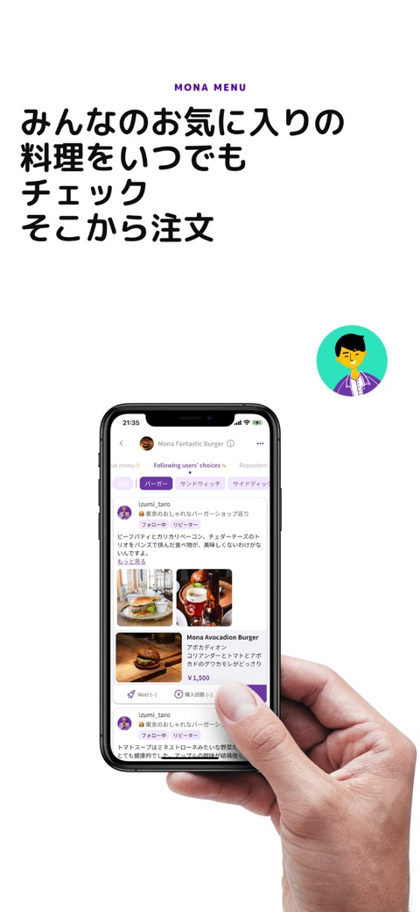
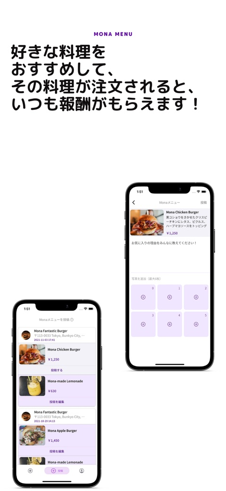
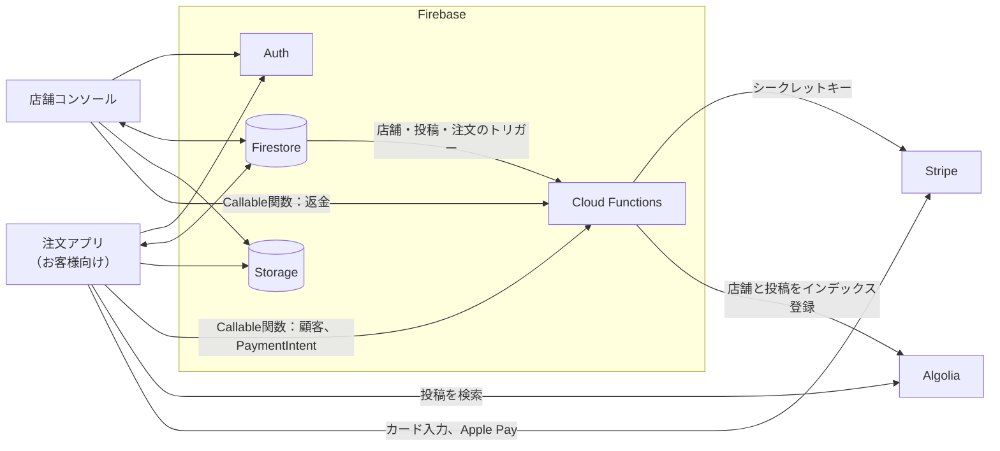

<p align="right"><a href="README.md">English</a> | <b>日本語</b></p>

# Mona Menu — 今までない注文体験

[](https://github.com/weichaist/mona-menu/actions/workflows/ci.yml)
[](LICENSE)


Mona Menu は、ソーシャル機能を備えた飲食店向けのモバイルオーダーシステムです。お客様は店舗のページを開き、メニューやほかのお客様が投稿した料理の写真を見ながら、テーブルから注文して Stripe（保存済みのカードまたは Apple Pay）で支払います。食後には、自分で撮った料理の写真を投稿してシェアできます。加盟店はタブレットの店舗コンソールで注文と返金に対応し、注文履歴の確認、常連客の承認、メニュー・営業時間・テーブル・プロフィールの編集を行います。

<table>
  <tr>
    <td align="center"><br><sub>今までない注文体験</sub></td>
    <td align="center"><br><sub>ライブオーダー機能：人気料理を簡単に注文</sub></td>
    <td align="center"><br><sub>みんなのお気に入りの料理をチェックして、そこから注文</sub></td>
    <td align="center"><br><sub>お気に入り店の認定リピーターになろう</sub></td>
    <td align="center"><br><sub>好きな料理をおすすめしよう</sub></td>
  </tr>
</table>

<sub>リリースされた注文アプリ（お客様向け）のスクリーンショットです（2021〜2022年）。</sub>

## 主な機能

- **ソーシャル機能付きの店舗ページ**：「店内メニュー」「最新の投稿」「リピーターのおすすめ」「フォロー中ユーザーのchoices」の各タブに加えて、たった今注文された料理が流れるライブオーダー表示があります。
- **テーブルから注文してアプリで支払い**（Stripe）：保存済みのカードと Apple Pay に対応しています。
- **料理の投稿**：お客様は食べた料理の写真と短いレビューを投稿し、リンクでシェアできます。投稿は検索できます（Algolia）。
- **リピーター**：お客様が店舗の常連客として申請し、店舗が店舗コンソールで承認します。
- **店舗コンソール**（タブレット向け）：届いた注文と返金、注文履歴、常連客、メニュー、営業時間、テーブル、プロフィールを扱います。
- 注文アプリ（お客様向け）は**日本語と英語**に対応しています。

このリポジトリは、1つの Firebase プロジェクトを共有する次の3つで構成されています。

- **注文アプリ（お客様向け）**（`apps/diner`）：Flutter。Android と iOS に対応。
- **店舗コンソール**（`apps/console`）：Flutter。タブレットの横向きレイアウトで、Android と iOS に対応。
- **Cloud Functions**（`functions`）：TypeScript。Stripe の呼び出しと Algolia へのインデックス登録を担当。

## 仕組み



- 2つのアプリはどちらも Firestore を直接読み書きします。誰が何をできるかは `firestore.rules` で決まります。
- Stripe のシークレットキーが必要な処理は、すべて Cloud Functions の Callable関数で実行します。アプリは Firestore のドキュメント `env/stripe_mode` から読み取った `mode`（`TEST` または `LIVE`）を一緒に送ります。
- Firestore トリガーが店舗と投稿を Algolia にコピーします。注文アプリは検索専用キーで `posts` インデックスを検索します。
- 店舗コンソールは、新しい店舗の住所を Google Places API (New) で検索します。

Firestore の全コレクションと、各アプリが呼び出す関数の一覧は [docs/architecture.md](docs/architecture.md) にあります。

## リポジトリ構成

```
mona-menu/
  apps/
    diner/                  Flutter 製の注文アプリ（お客様向け、Dart パッケージ mona_diner）
    console/                Flutter 製の店舗コンソール（Dart パッケージ mona_console）
  functions/                Cloud Functions（TypeScript、Node.js 22）
  docs/architecture.md      データモデル、関数、決済フロー
  firebase.json             Firebase CLI の設定（ルール、インデックス、関数）
  .firebaserc               Firebase プロジェクトのエイリアス（プレースホルダー）
  firestore.rules           Firestore のセキュリティルール
  firestore.indexes.json    アプリが使う複合インデックス
  storage.rules             Cloud Storage のセキュリティルール
  .github/workflows/ci.yml  アプリの解析とテスト、関数の lint とビルド
```

## 前提条件

- Flutter 3.47.9（Dart 3.13）。各アプリに [FVM](https://fvm.app) 用の `.fvmrc` があります。
- Node.js 22 と npm（`functions/.nvmrc`）。
- [Firebase CLI](https://firebase.google.com/docs/cli)（`npm install -g firebase-tools`）。必要に応じて [FlutterFire CLI](https://firebase.google.com/docs/flutter/setup) も使えます。
- アプリのビルドに、Android Studio / Android SDK と、CocoaPods を入れた Xcode。
- **Blaze** プランの Firebase プロジェクト（Cloud Functions が Stripe と Algolia を呼び出し、Secret Manager を使うため）。
- [Stripe](https://stripe.com) のアカウント、[Algolia](https://www.algolia.com) のアプリケーション、Maps SDK for Android/iOS と Places API (New) 用の Google Cloud プロジェクト（Firebase のプロジェクトで構いません）。

## セットアップ

### 1. Firebase プロジェクト

1. Firebase プロジェクトを作成し、Blaze プランにアップグレードします。
2. **Authentication**：**電話番号**（注文アプリ）と**メール / パスワード**（店舗コンソール）を有効にします。
3. **Firestore**：データベースを作成し、ロケーションを控えておきます。後述の `FIRESTORE_REGION` で使います。
4. **Storage**：デフォルトのバケットを作成します。
5. 「プロジェクトの設定」で4つのアプリを登録します。ID は元のものをそのまま使っても、独自のものにしても構いません（独自の ID にする場合は、各プラットフォームのフォルダ内の ID も変更してください）。

   | アプリ | Android パッケージ名 | iOS バンドル ID |
   | --- | --- | --- |
   | 注文アプリ（お客様向け） | `app.mona.mona_menu_r1` | `app.mona.monaMenuR1` |
   | 店舗コンソール | `app.mona.mona_restaurant_console` | `app.mona.monaRestaurantConsole` |

   Android で電話番号によるサインインを使うには、署名鍵の SHA-1 と SHA-256 を注文アプリの Android アプリに追加します。

### 2. ルールとインデックス

```bash
firebase use --add            # プロジェクトを選択（または .firebaserc を編集）
firebase deploy --only firestore,storage
```

### 3. Firestore のアプリ設定

次のドキュメントを Firestore コンソールで手動で作成します。アプリは `env` コレクションを読み取れますが、書き込みはできません。

| ドキュメント | フィールド |
| --- | --- |
| `env/stripe_mode` | `mode`：`"TEST"`（または `"LIVE"`） |
| `env/stripe_keys` | `TEST`：`pk_test_…` キー、`LIVE`：`pk_live_…` キー |
| `env/app_version` | `version`：注文アプリのバージョン（例：`"1.0.1"`）、`link`：バージョンが異なるときに表示するストアの URL |

`env/app_version` がないと、注文アプリはホーム画面にネットワークエラーのダイアログを表示します。

### 4. Stripe

Stripe ダッシュボードで、テスト用（本番運用では本番用も）のシークレットキーと公開可能キーを取得します。Apple Pay を使う場合は、Apple のマーチャント ID を作成し、その ID 用の Stripe の Apple Pay 証明書を追加します。マーチャント ID は `APPLE_MERCHANT_ID` と `apps/diner/ios/Runner/Runner.entitlements` で揃えておいてください（デフォルトは `merchant.app.mona`）。

### 5. Algolia

1. `posts` と `restaurant_accounts` の2つのインデックスを持つアプリケーションを作成します。
2. `posts` インデックスに、次の **attributes for faceting**（ファセット属性）を追加します（「filter only」で十分です）：`active`、`postedBy`、`restaurantUid`、`menuItemCategories`、`menuGroup`。
3. アプリケーション ID、関数用の管理用（書き込み可能な）API キー、注文アプリ用の検索専用キーを控えておきます。

### 6. Cloud Functions

```bash
firebase functions:secrets:set STRIPE_SECRET_KEY_TEST
firebase functions:secrets:set STRIPE_SECRET_KEY_LIVE
firebase functions:secrets:set STRIPE_PUBLISHABLE_KEY_TEST
firebase functions:secrets:set STRIPE_PUBLISHABLE_KEY_LIVE
firebase functions:secrets:set ALGOLIA_APP_ID
firebase functions:secrets:set ALGOLIA_ADMIN_KEY

cp functions/.env.example functions/.env   # FIRESTORE_REGION を設定
(cd functions && npm ci)
firebase deploy --only functions
```

シークレットはすべて登録しておく必要があります。テストモードしか使わない場合も、LIVE 用のシークレットにはプレースホルダーの値を入れてください。`FIRESTORE_REGION` はデータベースのロケーションに合わせます（`nam5` → `us-central1`、`eur3` → `europe-west1`、リージョンのデータベースならそのリージョン）。Callable関数は `us-central1` に置いたままにします。アプリがこのリージョンを呼び出すためです。

### 7. アプリの設定と実行

各アプリは、`--dart-define-from-file` で渡した JSON ファイルからビルド時に設定を読み込みます。

```bash
cd apps/diner        # または apps/console
cp config/example.json config/dev.json   # 値を記入
flutter pub get
flutter run --dart-define-from-file=config/dev.json
```

注文アプリには、`android/local.properties` と `ios/Flutter/Secrets.xcconfig` に Google Maps のキーも必要です。詳しくは [apps/diner/README.md](apps/diner/README.md) と [apps/console/README.md](apps/console/README.md) を参照してください。`FIREBASE_*` の値を設定する代わりに、`flutterfire configure` で `lib/firebase_options.dart` を再生成することもできます。

### 8. 加盟店の追加

店舗コンソールにはサインアップ画面がありません。また、店舗ドキュメントがすでにあるアカウントでしか開けません。

1. Firebase コンソール > Authentication：メールアドレスとパスワードでユーザーを追加します。
2. Firestore：`restaurant_accounts/{そのユーザーの uid}` を作成し、`uid: "<その uid>"`、`onboardingCompleted: false`、`public: false` を設定します。
3. 加盟店が店舗コンソールにサインインしてオンボーディングを完了し、「設定」で営業時間、ランチとディナーのメニュー、テーブル番号を設定します。
4. ドキュメントに `public: true` を設定すると、注文アプリに店舗が表示されます。

## 設定項目

| 名前 | 設定場所 | 参照元 | 用途 |
| --- | --- | --- | --- |
| `FIREBASE_PROJECT_ID`, `FIREBASE_MESSAGING_SENDER_ID`, `FIREBASE_STORAGE_BUCKET` | `apps/*/config/<name>.json` | 両アプリ | Firebase プロジェクト |
| `FIREBASE_ANDROID_API_KEY`, `FIREBASE_ANDROID_APP_ID`, `FIREBASE_IOS_API_KEY`, `FIREBASE_IOS_APP_ID` | `apps/*/config/<name>.json` | 両アプリ | Firebase のアプリ登録情報 |
| `ALGOLIA_APP_ID`, `ALGOLIA_SEARCH_KEY` | `apps/diner/config/<name>.json` | 注文アプリ | `posts` インデックスの検索（検索専用キー） |
| `APPLE_MERCHANT_ID` | `apps/diner/config/<name>.json` | 注文アプリ | Apple Pay のマーチャント ID（デフォルトは `merchant.app.mona`） |
| `SHARE_BASE_URL` | `apps/diner/config/<name>.json` | 注文アプリ | 投稿をシェアするときのリンク：`<base>/post/<id>` |
| `TERMS_URL` | `apps/*/config/<name>.json` | 両アプリ | サインイン画面からリンクする利用規約ページ |
| `GOOGLE_PLACES_API_KEY` | `apps/console/config/<name>.json` | 店舗コンソール | オンボーディング中の Places API (New) 検索 |
| `SUPPORT_EMAIL` | `apps/console/config/<name>.json` | 店舗コンソール | 「設定」に表示する問い合わせ先アドレス |
| `MAPS_API_KEY` | `apps/diner/android/local.properties` または環境変数 | 注文アプリ（Android） | Maps SDK for Android |
| `MAPS_API_KEY` | `apps/diner/ios/Flutter/Secrets.xcconfig` | 注文アプリ（iOS） | Maps SDK for iOS |
| `FIREBASE_IOS_URL_SCHEME` | `apps/diner/ios/Flutter/Secrets.xcconfig` | 注文アプリ（iOS） | 電話番号によるサインイン用の URL スキーム（エンコード済みアプリ ID） |
| `STRIPE_SECRET_KEY_TEST`, `STRIPE_SECRET_KEY_LIVE` | Functions のシークレット | Cloud Functions | Stripe API の呼び出し |
| `STRIPE_PUBLISHABLE_KEY_TEST`, `STRIPE_PUBLISHABLE_KEY_LIVE` | Functions のシークレット | Cloud Functions | `fetchStripePubKey` が返す値 |
| `ALGOLIA_APP_ID`, `ALGOLIA_ADMIN_KEY` | Functions のシークレット | Cloud Functions | Algolia インデックスへの書き込み |
| `FIRESTORE_REGION` | `functions/.env` | Cloud Functions | Firestore トリガーのリージョン |
| `env/stripe_mode`, `env/stripe_keys`, `env/app_version` | Firestore のドキュメント | アプリ | Stripe のモード、公開可能キー、アップデートの案内 |

実際の値を入れたファイル（`example.json` 以外の `config/*.json`、`local.properties`、`Secrets.xcconfig`、`key.properties`、`functions/.env`）は、どれもコミットされていません。`.gitignore` で除外しています。

## プロジェクトの状況

Mona Menu は 2020〜2022年に開発され、2026年にオープンソース化されました。公開にあたって、アプリを Dart 2.15 から Flutter 3.47.9 / Dart 3.13 にアップグレードし、プラグインを最新バージョンに更新して、Android/iOS プロジェクトを再生成しました。関数は Node.js 22、`firebase-functions` 7（第2世代 API）、`firebase-admin` 14、Stripe SDK 23、Algolia 5 に移行しています。コードは `flutter analyze`、`flutter test`、ESLint、`tsc` を通過していますが、アップグレード後は実機でも、実際のサービスにつないだ状態でも動かしていません。

### 既知の制限

- **決済が完了しません**。注文アプリは Stripe の PaymentIntent を作成して注文を記録しますが、その PaymentIntent を確定する処理がありません（`confirmPaymentIntent` はありますが、使われていません）。
- **新しい注文が店舗コンソールのホーム画面に表示されません**。注文は `orderStatus: "ordered"` で作成されますが、店舗コンソールのホームには `paid` の注文が並び、`paid` に変える処理はどこにもありません。注文履歴には表示されます。
- **プッシュ通知がつながっていません**。`sendOrderNotificationToRestaurant` は `restaurant_accounts/{uid}.tokens` に送信しますが、どちらのアプリもデバイストークンを登録していません。
- **Stripe の Callable関数は入力をそのまま信用します**。サインイン済みのユーザーなら誰でも、任意の金額、顧客、PaymentIntent ID を指定して呼び出せます（返金も含みます）。
- **注文はサインイン済みのお客様全員から見えます**（店舗ページにその日の注文が表示されるため）。注文ドキュメントには Stripe の PaymentIntent ID、クライアントシークレット、支払い方法 ID が含まれます。加盟店のメールアドレスを含む店舗ドキュメントは、誰でも読み取れます。
- 店舗コンソールの写真アップロードは、iOS の一時ファイルのパスからストレージのパスを組み立てています。Android では失敗する可能性が高いです。
- 店舗の `uid` と `public` は手動で設定する必要があります（手順 8 を参照）。

## コントリビュート

[CONTRIBUTING.md](CONTRIBUTING.md) を参照してください。

## ライセンス

MIT — [LICENSE](LICENSE) を参照してください。Mona Menu の名称とロゴは、このライセンスの対象外です。
