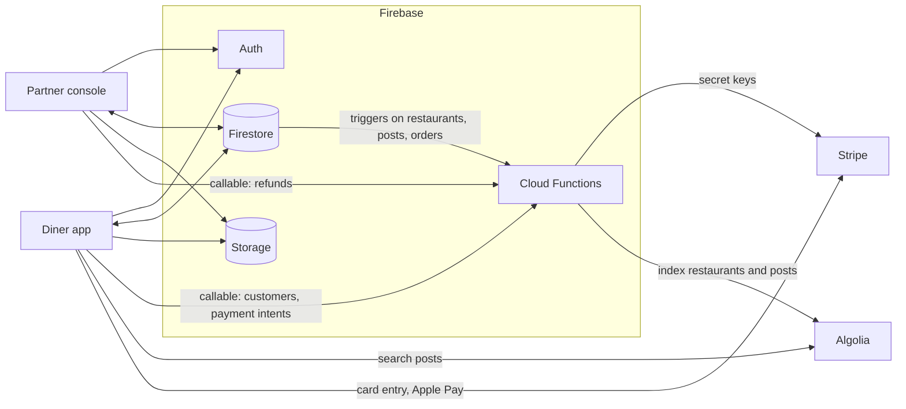

# Mona Menu — mobile order reimagined

Mona Menu is a mobile ordering system for restaurants with a social layer.
Diners open a restaurant's page, browse its menu and the dish photos other
diners posted, order from their table and pay with Stripe (saved cards or
Apple Pay). After eating they can post their own photos of a dish and share
the post. Restaurant partners run a tablet console to handle orders and
refunds, see order history, approve regular customers, and edit their menus,
business hours, tables and profile.

The repository holds three parts that share one Firebase project:

- **Diner app** (`apps/diner`): Flutter, Android and iOS.
- **Partner console** (`apps/console`): Flutter, landscape tablet layout, Android and iOS.
- **Cloud Functions** (`functions`): TypeScript; Stripe calls and Algolia indexing.

## How it works



- Both apps read and write Firestore directly; `firestore.rules` decides who
  may do what.
- Anything that needs a Stripe secret key runs in a callable Cloud Function.
  The apps send a `mode` (`TEST` or `LIVE`) that they read from the Firestore
  document `env/stripe_mode`.
- Firestore triggers copy restaurants and posts into Algolia. The diner app
  searches the `posts` index with a search-only key.
- The console looks up a new restaurant's address with the Google Places API
  (New).

[docs/architecture.md](docs/architecture.md) lists every Firestore collection
and which function each app calls.

## Repository layout

```
mona-menu/
  apps/
    diner/                  Flutter diner app (Dart package mona_diner)
    console/                Flutter partner console (Dart package mona_console)
  functions/                Cloud Functions (TypeScript, Node.js 22)
  docs/architecture.md      Data model, functions, payment flow
  firebase.json             Firebase CLI config (rules, indexes, functions)
  .firebaserc               Firebase project alias (placeholder)
  firestore.rules           Firestore security rules
  firestore.indexes.json    Composite indexes used by the apps
  storage.rules             Cloud Storage security rules
  .github/workflows/ci.yml  Analyze and test the apps, lint and build the functions
```

## Prerequisites

- Flutter 3.47.9 (Dart 3.13). Each app has a `.fvmrc` for
  [FVM](https://fvm.app).
- Node.js 22 and npm (`functions/.nvmrc`).
- [Firebase CLI](https://firebase.google.com/docs/cli) (`npm install -g firebase-tools`);
  optionally the [FlutterFire CLI](https://firebase.google.com/docs/flutter/setup).
- Android Studio / Android SDK and Xcode with CocoaPods to build the apps.
- A Firebase project on the **Blaze** plan (Cloud Functions call Stripe and
  Algolia, and use Secret Manager).
- A [Stripe](https://stripe.com) account, an [Algolia](https://www.algolia.com)
  application, and a Google Cloud project (the Firebase one is fine) for the
  Maps SDK for Android/iOS and the Places API (New).

## Setup

### 1. Firebase project

1. Create a Firebase project and upgrade it to Blaze.
2. **Authentication**: enable **Phone** (diner app) and **Email/Password**
   (console).
3. **Firestore**: create the database and note its location; you need it for
   `FIRESTORE_REGION` below.
4. **Storage**: create the default bucket.
5. Register four apps under Project settings, keeping the original ids or
   using your own (then change them in the platform folders too):

   | App | Android package | iOS bundle id |
   | --- | --- | --- |
   | Diner | `app.mona.mona_menu_r1` | `app.mona.monaMenuR1` |
   | Console | `app.mona.mona_restaurant_console` | `app.mona.monaRestaurantConsole` |

   For phone sign-in on Android, add your signing key's SHA-1 and SHA-256 to
   the diner's Android app.

### 2. Rules and indexes

```bash
firebase use --add            # pick your project; or edit .firebaserc
firebase deploy --only firestore,storage
```

### 3. App settings in Firestore

Create these documents by hand (Firestore console). The apps can read but not
write the `env` collection.

| Document | Fields |
| --- | --- |
| `env/stripe_mode` | `mode`: `"TEST"` (or `"LIVE"`) |
| `env/stripe_keys` | `TEST`: your `pk_test_…` key, `LIVE`: your `pk_live_…` key |
| `env/app_version` | `version`: the diner app version, e.g. `"1.0.1"`; `link`: the store URL shown when versions differ |

The diner app shows a network-error dialog on its home screen if
`env/app_version` is missing.

### 4. Stripe

Get the test (and, for production, live) secret and publishable keys from the
Stripe dashboard. For Apple Pay, create an Apple merchant id, add a Stripe
Apple Pay certificate for it, and keep it in sync with `APPLE_MERCHANT_ID` and
`apps/diner/ios/Runner/Runner.entitlements` (default `merchant.app.mona`).

### 5. Algolia

1. Create an application with two indices: `posts` and `restaurant_accounts`.
2. In the `posts` index, add these **attributes for faceting** (filter only is
   enough): `active`, `postedBy`, `restaurantUid`, `menuItemCategories`,
   `menuGroup`.
3. Note the application id, an admin (write) API key for the functions, and a
   search-only key for the diner app.

### 6. Cloud Functions

```bash
firebase functions:secrets:set STRIPE_SECRET_KEY_TEST
firebase functions:secrets:set STRIPE_SECRET_KEY_LIVE
firebase functions:secrets:set STRIPE_PUBLISHABLE_KEY_TEST
firebase functions:secrets:set STRIPE_PUBLISHABLE_KEY_LIVE
firebase functions:secrets:set ALGOLIA_APP_ID
firebase functions:secrets:set ALGOLIA_ADMIN_KEY

cp functions/.env.example functions/.env   # set FIRESTORE_REGION
(cd functions && npm ci)
firebase deploy --only functions
```

Every secret must exist; give the live ones a placeholder if you only use
test mode. `FIRESTORE_REGION` must match the database location (`nam5` →
`us-central1`, `eur3` → `europe-west1`, a regional database → its region).
The callable functions stay in `us-central1`, the region the apps call.

### 7. Configure and run the apps

Each app reads its configuration at build time from a JSON file passed with
`--dart-define-from-file`:

```bash
cd apps/diner        # or apps/console
cp config/example.json config/dev.json   # fill it in
flutter pub get
flutter run --dart-define-from-file=config/dev.json
```

The diner app also needs Google Maps keys in `android/local.properties` and
`ios/Flutter/Secrets.xcconfig`. See [apps/diner/README.md](apps/diner/README.md)
and [apps/console/README.md](apps/console/README.md). As an alternative to
the `FIREBASE_*` values, `flutterfire configure` regenerates
`lib/firebase_options.dart`.

### 8. Add a restaurant partner

The console has no sign-up screen, and it only opens for accounts that already
have a restaurant document:

1. Firebase console > Authentication: add a user with email and password.
2. Firestore: create `restaurant_accounts/{that user's uid}` with
   `uid: "<the uid>"`, `onboardingCompleted: false`, `public: false`.
3. The partner signs in to the console, completes onboarding, then sets
   business hours, lunch and dinner menus and table numbers in Settings.
4. Set `public: true` on the document to list the restaurant in the diner app.

## Configuration

| Name | Where | Used by | Purpose |
| --- | --- | --- | --- |
| `FIREBASE_PROJECT_ID`, `FIREBASE_MESSAGING_SENDER_ID`, `FIREBASE_STORAGE_BUCKET` | `apps/*/config/<name>.json` | both apps | Firebase project |
| `FIREBASE_ANDROID_API_KEY`, `FIREBASE_ANDROID_APP_ID`, `FIREBASE_IOS_API_KEY`, `FIREBASE_IOS_APP_ID` | `apps/*/config/<name>.json` | both apps | Firebase app registrations |
| `ALGOLIA_APP_ID`, `ALGOLIA_SEARCH_KEY` | `apps/diner/config/<name>.json` | diner | Search the `posts` index (search-only key) |
| `APPLE_MERCHANT_ID` | `apps/diner/config/<name>.json` | diner | Apple Pay merchant id (default `merchant.app.mona`) |
| `SHARE_BASE_URL` | `apps/diner/config/<name>.json` | diner | Link shared for a post: `<base>/post/<id>` |
| `TERMS_URL` | `apps/*/config/<name>.json` | both apps | Terms page linked from sign-in |
| `GOOGLE_PLACES_API_KEY` | `apps/console/config/<name>.json` | console | Places API (New) lookup during onboarding |
| `SUPPORT_EMAIL` | `apps/console/config/<name>.json` | console | Contact address in Settings |
| `MAPS_API_KEY` | `apps/diner/android/local.properties` or env var | diner (Android) | Maps SDK for Android |
| `MAPS_API_KEY` | `apps/diner/ios/Flutter/Secrets.xcconfig` | diner (iOS) | Maps SDK for iOS |
| `FIREBASE_IOS_URL_SCHEME` | `apps/diner/ios/Flutter/Secrets.xcconfig` | diner (iOS) | Encoded App ID URL scheme for phone sign-in |
| `STRIPE_SECRET_KEY_TEST`, `STRIPE_SECRET_KEY_LIVE` | Functions secret | functions | Stripe API calls |
| `STRIPE_PUBLISHABLE_KEY_TEST`, `STRIPE_PUBLISHABLE_KEY_LIVE` | Functions secret | functions | Returned by `fetchStripePubKey` |
| `ALGOLIA_APP_ID`, `ALGOLIA_ADMIN_KEY` | Functions secret | functions | Write to the Algolia indices |
| `FIRESTORE_REGION` | `functions/.env` | functions | Region of the Firestore triggers |
| `env/stripe_mode`, `env/stripe_keys`, `env/app_version` | Firestore documents | apps | Stripe mode, publishable keys, update prompt |

None of the real files (`config/*.json` other than `example.json`,
`local.properties`, `Secrets.xcconfig`, `key.properties`, `functions/.env`)
are committed; `.gitignore` covers them.

## Project status

Mona Menu was built between 2020 and 2022 and open-sourced in 2026. For the
release the apps were upgraded from Dart 2.15 to Flutter 3.47.9 / Dart 3.13
with current plugin versions and regenerated Android/iOS projects, and the
functions moved to Node.js 22, `firebase-functions` 7 (2nd-gen API),
`firebase-admin` 14, Stripe SDK 23 and Algolia 5. The code passes
`flutter analyze`, `flutter test`, ESLint and `tsc`, but it has not been run
on devices or against live services since the upgrade.

### Known limitations

- **Payments are not captured.** The diner app creates a Stripe PaymentIntent
  and records the order, but nothing confirms the intent
  (`confirmPaymentIntent` exists and is unused).
- **New orders don't reach the console's home screen.** Orders are created
  with `orderStatus: "ordered"`, the console's home lists `paid` orders, and
  nothing sets `paid`. They do appear in the console's order history.
- **Push notifications are not wired.** `sendOrderNotificationToRestaurant`
  sends to `restaurant_accounts/{uid}.tokens`, but neither app registers
  device tokens.
- **The Stripe callables trust their input.** Any signed-in user can call
  them with any amount, customer or PaymentIntent id (including refunds).
- **Orders are visible to every signed-in diner** (the restaurant page shows
  what was ordered today), and order documents include the Stripe intent id,
  client secret and payment method id. Restaurant documents, including the
  partner's email, are publicly readable.
- Console photo uploads build their storage path from an iOS temporary-file
  path; on Android they are likely to fail.
- Restaurants need `uid` and `public` set by hand (see step 8).

## Contributing

See [CONTRIBUTING.md](CONTRIBUTING.md).

## License

MIT — see [LICENSE](LICENSE). The Mona Menu name and logos are not covered by
the license.
