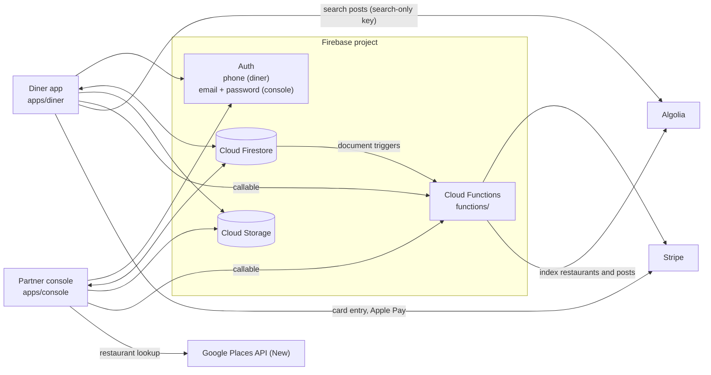

# Architecture

Mona Menu has two Flutter apps that talk to one Firebase project directly
(Auth, Firestore, Storage) and to a small set of Cloud Functions. The functions
hold the Stripe secret keys and keep two Algolia indices in sync with Firestore.

## Firestore collections

| Path | Written by | Read by | Contents |
| --- | --- | --- | --- |
| `env/stripe_mode` | you, by hand | diner, console | `{mode: "TEST" \| "LIVE"}`: which Stripe keys to use. Sent as `mode` to every Stripe function. |
| `env/stripe_keys` | you, by hand | diner | `{TEST: "pk_test_…", LIVE: "pk_live_…"}`: the publishable key the diner app hands to the Stripe SDK. |
| `env/app_version` | you, by hand | diner | `{version: "1.0.1", link: "<store URL>"}`. If the installed version differs, the diner app shows an update dialog. The document must exist; without it the app shows its network-error dialog on the home screen. |
| `app_users/{uid}` | diner | diner, console | Diner profile: `displayName`, `firstName`, `lastName`, `bio`, `profilePictureURL`, `onboarded`, timestamps. |
| `app_users/{uid}/secrets/{uid}` | diner | diner (owner) | Phone number, email and other private profile fields. |
| `app_users/{uid}/stripe_data/StripeCustomerId` | diner | diner (owner) | `{id}`: the Stripe customer created by `createStripeCustomer`. |
| `app_users/{uid}/payment_methods/{last4+expiry}` | diner | diner (owner) | Saved cards: Stripe payment method id, brand, last 4, expiry, `active`. |
| `app_users/{uid}/counters/user_following` / `user_followed_by` | diner | diner | `{list: [uid, …]}` follow lists. |
| `app_users/{uid}/user_following/{uid}`, `user_followed_by/{uid}` | diner | diner | One document per follow relationship (`status`, `timeStamp`). |
| `restaurant_accounts/{uid}` | console (you create it first, see README) | diner, console, functions | Restaurant profile: name, address, `_geoloc`, genre, phone, about, images, business hours, lunch/dinner categories, `tableNumbers`, `serviceCharge`, `eatIn`/`takeout`, `seatAvailableNow`, `onboardingCompleted`, `public`, `uid`, optional `tokens` (FCM). |
| `restaurant_accounts/{uid}/menu/{itemId}` | console | diner, console | Dishes: title, description, price, categories, `menuGroup` (`lunch`/`dinner`), `ranking`, `active`, image. |
| `restaurant_accounts/{uid}/repeaters/{dinerUid}` | diner (applies), console (approves) | diner, console | Regular-customer applications: `status` (`applied`, `approved`, …). |
| `restaurant_accounts/{uid}/customer_orders/{orderId}` | diner (creates), console (status) | diner, console, functions | Orders: items, table, total, tax, `orderStatus`, `menuGroup`, `orderedBy`, Stripe intent id, payment method label. |
| `…/customer_orders/{orderId}/menuItems/{id}` | diner (creates), console (status) | diner, console | One document per ordered dish. Dishes ordered from a diner's post carry `affiliateUserUid` / `affiliatePostId` (the post author's "rewards"). |
| `posts/{postId}` | diner | diner, console, functions | Dish posts: photos, comment, dish, restaurant, `postedBy`, `postedAt`, `active`, `rankingScore`. |
| `abuse_reports/{id}` | diner | nobody in this repo | Reports filed from a post's menu. |
| `creator_mona_menu`, `mona_menu_follow_relationship` | nothing in this repo | diner | Read by the diner app; they were filled by tooling that is not part of this repository. |

`firestore.rules` encodes the access in the table above, and
`firestore.indexes.json` holds the composite indexes the apps' queries need.

## Cloud Storage

| Path | Written by |
| --- | --- |
| `app_users/{uid}/profile/…` | diner: profile pictures and post photos |
| `restaurant_accounts/{uid}/…` | console: restaurant profile/background pictures and dish photos |

Images are shown through download URLs stored in Firestore.

## Cloud Functions

All functions are 2nd-gen (`firebase-functions/v2`). Callables run in the
default region (`us-central1`), which is where the Flutter apps' default
`FirebaseFunctions.instance` sends calls. The Firestore triggers run in
`FIRESTORE_REGION`, which must match the database location.

| Function | Type | Called by | What it does |
| --- | --- | --- | --- |
| `fetchStripePubKey` | callable | diner (on start and when a restaurant opens; the result is not used) | Returns the publishable key for `mode`. |
| `createStripeCustomer` | callable | diner, when the first card is saved | Creates a Stripe customer for the user. |
| `createStripePaymentIntent` | callable | diner, at checkout (saved card or Apple Pay) | Creates a PaymentIntent (JPY) for the order total. |
| `refundStripePayment` | callable | console, when an order is refunded | Refunds the order's PaymentIntent. |
| `retrieveStripePaymentMethodDetails` | callable | not called by these apps | Returns a payment method. |
| `confirmPaymentIntent` | callable | not called by these apps | Confirms a PaymentIntent with a payment method. |
| `cancelStripePayment` | callable | not called by these apps | Cancels a PaymentIntent. |
| `restaurantAddToIndex`, `restaurantUpdateIndex`, `restaurantDeleteIndex` | Firestore trigger on `restaurant_accounts/{id}` | — | Mirror restaurants into the Algolia index `restaurant_accounts` (not queried by these apps). |
| `postAddToIndex`, `postUpdateIndex`, `postDeleteIndex` | Firestore trigger on `posts/{id}` | — | Mirror posts into the Algolia index `posts`. |
| `sendOrderNotificationToRestaurant` | Firestore trigger on `restaurant_accounts/{uid}/customer_orders/{id}` | — | Sends a push notification to the device tokens in `restaurant_accounts/{uid}.tokens`. Neither app registers tokens yet. |

Every Stripe callable receives `mode` from the app: `"TEST"` uses
`STRIPE_SECRET_KEY_TEST` / `STRIPE_PUBLISHABLE_KEY_TEST`, any other value uses
the live keys. The apps read the mode from `env/stripe_mode`.

## Algolia

The diner app queries the `posts` index for a restaurant's posts by its
regulars ("repeaters") and by the people the diner follows. Its facet filters
use `active`, `postedBy`, `restaurantUid`, `menuItemCategories` and
`menuGroup`, so those attributes must be listed under the index's
**Facets** (attributes for faceting). Firestore timestamps reach Algolia as
`{_seconds, _nanoseconds}`, which is what the app parses.

## Payments flow (as built)

1. The diner saves a card with the Stripe card field. The app calls
   `createStripeCustomer` once, creates a Stripe payment method on the device
   and stores its id under `app_users/{uid}/payment_methods`.
2. At checkout the app calls `createStripePaymentIntent` (customer + card, or
   `customerId: "ApplePay"` for Apple Pay), then writes the order to
   `restaurant_accounts/{uid}/customer_orders` with the intent id and
   `orderStatus: "ordered"`.
3. The console's home screen lists today's orders with `orderStatus: "paid"`;
   a partner marks them `confirmed` or refunds them with `refundStripePayment`
   (`refunded`). The order history lists every order.

Two steps are missing from this repository:

- Nothing confirms the PaymentIntent (the `confirmPaymentIntent` function
  exists but no app calls it), so no payment is captured.
- Nothing moves an order from `ordered` to `paid`, so new orders only show in
  the console's order history, not on its home screen.

See "Known limitations" in the README.
